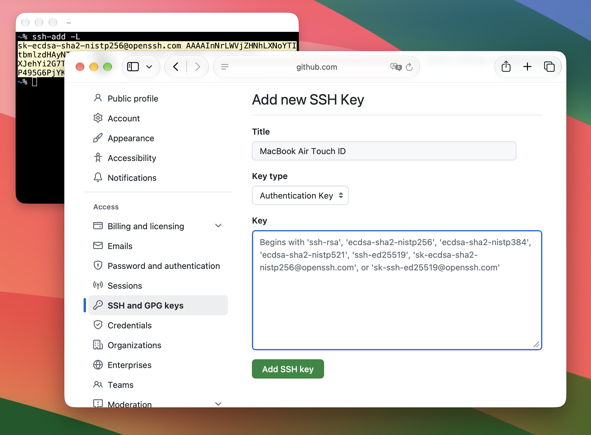
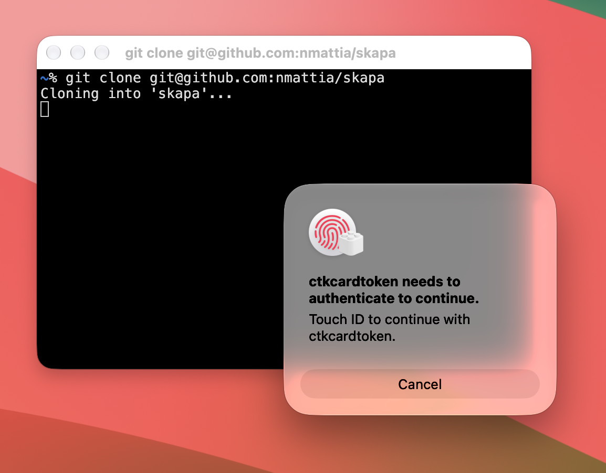

In the first part of this post I'll show a simple, secure way to create an SSH key on Mac (it's 3 commands, including support for GitHub). In the second part I'll dig deeper and explain what's actually happening for the curious reader.

<!--more-->

Macs have a built-in so-called [Secure Enclave](https://support.apple.com/en-gb/guide/security/sec59b0b31ff/web), where we can create "identities" that simply cannot be stolen (unless maybe you've made enemies with a nation state). Those identities are protected with Touch ID and can be used for SSH authentication. There are some great benefits about using this over traditional SSH key files:

- The private material cannot be extracted, is never shown, cannot be stolen,
- You get prompted whenever the identity is used,
- No key files (like `~/.ssh/id_ed25519.pub` and friends) littering the file system; and there's no risk of mistakenly deleting them either.

This extra security will be in effect whenever you use SSH, including git-over-ssh like GitHub. It's great that advanced security tech is available by default on some of the most widely distributed computers in the world! A few years ago stuff like this could only be found at CERN and/or in Dan Brown novels. Let's see how it can be set up on your consumer-grade Mac.

> It is essential that the human interface be designed for ease of use, so that users routinely and automatically apply the protection mechanisms correctly.
>
> - Saltzer and Schroeder, "The Protection of Information in Computer Systems"

## Quick Setup

We'll create a secure identity on the Secure Enclave, then tell SSH how to use it for authentication, and finally add the key to GitHub.

### Step 1: create the identity that you'll use on this Mac:

```bash
sc_auth create-ctk-identity -l ssh-key -k p-256-ne -t bio # run once to create identity
```

You'll be prompted to touch "Touch ID". Your identity is now created and saved securely (parameters are explained in the [deep dive](#under-the-hood) below).

### Step 2: tell SSH to use the identity (when prompted for a PIN, just hit enter):

```bash
ssh-add -K -S /usr/lib/ssh-keychain.dylib # run after a reboot
```

From here on, SSH will know to use the identity from the Secure Enclave when connecting via SSH; it does not have a good memory so you'll need to remind it after a reboot.

### Step 3: Whenever you need to register your key to a new server (like GitHub), run this command:

```bash
ssh-add -L # run when you need the public key
```

If multiple identities are listed, use the line that starts with `sk-ecdsa-sha2-nistp256...`. It's a shareable handle for the identity, and this is the SSH key that GitHub will ask about.



_The output of `ssh-add -L` can be added as a GitHub SSH Key_

That's all you need for a super secure setup! The new identity can now be used with SSH, and you'll be prompted for Touch ID during authentication:

```bash
git push # triggers Touch ID prompt
```

No one can steal your identity (well, you can't even give it away willingly since it can't be extracted from the Secure Enclave), but with great powers etc: if your Mac dies, so does the identity, and you'll need to create a new one (and re-register it where necessary, like GitHub).



_You'll get a Touch ID prompt when git tries to authenticate with SSH_

If you're curious about how this works, read on!

## Under the hood

We'll now try to understand what happens under the hood. We'll start with the actual identity creation in the Secure Enclave, then look at how SSH is allowed to interface with the Secure Enclave with `ssh-keychain.dylib`, and then try to see what happens in a complete SSH sign-in flow.

This is the result of reading posts (like [this great investigation by `arianvp`](https://gist.github.com/arianvp/5f59f1783e3eaf1a2d4cd8e952bb4acf)), manual pages, and experimentation. A lot of this is undocumented, and this is the minimum information I needed to form a mental model of what's happening and convince myself that it does, indeed, work.

> [!NOTE]
>
> Some of the command outputs below have been trimmed for legibility, I invite you to run them locally if you want the full experience!

### Creating an identity on the Secure Enclave

Identities are managed with the `sc_auth` command (where `sc_` stands for Smart Card). In Apple-speak, they are "CryptoTokenKit" identities, or CTK identities for short. Why not Smart Card Identities? What is a Smart Card? No idea! There's a lot of weird Apple vocabulary, but in practice they're just private keys stored on the Secure Enclave:

```
$ sc_auth list-ctk-identities
Key Type Public Key Hash                          Prot Label
p-256-ne 458F712F281B53C683F23FC02E69D44DAFDAA3DE bio  ssh-key
```

If you followed along in the [Quick Setup](#quick-setup), you should have exactly one identity here, that was created when you ran the `sc_auth create-ctk-identity` command. Let's look at the `create-ctk-identity` command in more detail:

```
sc_auth create-ctk-identity -l <label> -k <key type> -t <protection>
```

When using the `p-256-ne` key type, this command creates the identity on the Secure Enclave — I'm guessing by first gathering some entropy, then generating some private key material and allocating whatever it needs for bookkeeping and ensuring it can only be accessed with your fingerprint.

The label is freeform and just a note attached to the key. The key type is a cryptographic setting (the elliptic curve used). At the time of writing, the following values are accepted: `p-256|p-384|p-521|p-256-ne|p-384-ne`. The `-ne` suffix means "Non-Extractable", meaning the key is generated by the enclave itself and _cannot_ be extracted from the Secure Enclave. For SSH we only need _signing_, which is done by (and _on_) the Secure Enclave itself, and at no point do we need (or want) to export the private key. The `p-384` curve is not supported by (Open)SSH, so this narrows it down to `p-256-ne`.

Finally, `protection` can be either `bio` or `none`. When set to `bio`, using the key requires biometrics (like Touch ID). With `none`, the key _still_ cannot be extracted (i.e. stolen) _but_ programs would be able to silently use SSH; I recommend using `bio`, but YMMV; if you get annoyed by the Touch ID prompts whenever you `git pull`, you might want to use `none` here.

Now that we have some elusive identity on the Secure Enclave, let's see how we can tell SSH to use it for authentication.

### Translating between SSH and the Secure Enclave

There's a bit of impedance mismatch, and `ssh` doesn't know how to use the identity by default:

```
$ ssh -T git@github.com
git@github.com: Permission denied (publickey).
```

The SSH agent cannot use the Secure Enclave identities as-is, but Apple has us covered with a small translation layer in the form of `ssh-keychain.dylib`, a `dlopen`-able library available natively on all recent macOS versions:

```
$ ssh-add -K -S /usr/lib/ssh-keychain.dylib
...
Resident identity added: ECDSA-SK SHA256:QZ+Cx6/AkS9sek9INtsXt6t7wuHOtA555CLJu8a8V7w
```

Here we're relying on `ssh-add`'s built-in support for FIDO-style authenticator via the `-K` parameter. This lets the SSH agent know that it shouldn't read a standard private key (for instance `~/.ssh/id_ed25519`) but that it should expect the keys to be stored "externally" (for a lack of better words). With `-K` alone, `ssh-add` would look for public keys on USB devices (think YubiKey); though we can customize this behavior by registering a "security key provider" with `-S <provider>`. This provider should be a stateless dynamically-loadable library, which is exactly what `/usr/lib/ssh-keychain.dylib` is. The interface is not documented (at least not in a way I was able to meaningfully process), but we can have a look at what `ssh-keychain.dylib` exposes:

```
$ dyld_info -exports /usr/lib/ssh-keychain.dylib
/usr/lib/ssh-keychain.dylib:
    -exports:
        offset      symbol
        0x00001A2C  _C_GetFunctionList
        0x00000F30  _sk_api_version
        0x00000F38  _sk_enroll
        0x0000136C  _sk_load_resident_keys
        0x00000F40  _sk_sign
```

Most likely, `_sk_load_resident_keys` is meant to return a list of (public keys of) identities, and `_sk_sign` will sign a payload using a specified identity (here, resident means "residing on e.g. the Secure Enclave").

We've seen how the identities can be created on the Secure Enclave, and how they can, in theory, be used by the SSH agent. Let's put this to the test and see what happens when an SSH connection is created.

### SSH Sign-in flow with the ssh-keychain provider

Let's see what we need for authenticating to a remote SSH server. At all times, the SSH agent needs (1) a list of (public) keys that can be used to authenticate, and (2) a way to prove to a server that it has the corresponding private key for any of those keys.

When `ssh-add` is first called with `-S <provider>`, the `_sk_load_resident_keys` routine is called, which returns the public keys of all resident keys on the FIDO-style authenticator. Those are stored in the SSH agent (alongside their corresponding provider, namely `ssh-keychain.dylib`) and will later be offered as candidates to any remote SSH server we try connecting to. (Also now that the SSH agent knows about the Secure Enclave identity we created earlier, we can view its SSH-style public key with `ssh-add -L`.)

Let's say an SSH connection is initiated: the remote accepts one of those public keys offered by the agent and "challenges" the client to prove its identity. The agent calls `_sk_sign` to create a signature with the private key (matching the accepted public key) and the challenge (roughly speaking). This will be forwarded to the Secure Enclave, prompt Touch ID, and if approved, will return a signature for the challenge. The signature is forwarded back to the server, which can confirm we — the client — have the corresponding private key.

Let's see what this looks like in practice:

```
$ ssh -T git@github.com
git@github.com: Permission denied (publickey).
$ ssh-add -K -S /usr/lib/ssh-keychain.dylib
Enter PIN for authenticator:
Resident identity added: ...
$ ssh -vvv -T git@github.com
debug1: get_agent_identities: agent returned 1 keys
debug1: Offering public key: ssh: ECDSA-SK SHA256:QZ+Cx6/AkS9sek9INtsXt6t7wuHOtA555CLJu8a8V7w authenticator agent
debug1: Server accepts key: ssh: ECDSA-SK SHA256:QZ+Cx6/AkS9sek9INtsXt6t7wuHOtA555CLJu8a8V7w authenticator agent
debug3: sign_and_send_pubkey: signing using sk-ecdsa-sha2-nistp256@openssh.com SHA256:QZ+Cx6/AkS9sek9INtsXt6t7wuHOtA555CLJu8a8V7w
<at this point, Touch ID prompt appears>
Authenticated to github.com ([20.250.119.67]:22) using "publickey".
Hi nmattia! You've successfully authenticated, but GitHub does not provide shell access.
```

The `ssh` debug logs show that one key is offered by the agent, accepted, and then used to create a signature. After the server has verified the signature, authentication is granted (although `GitHub does not provide shell access`).

One note: whenever we register the identity with the SSH agent, `ssh-add` prompts us for a PIN. What gives? Why does entering an empty PIN work, isn't this mighty unsafe‽

Well, no, it's not unsafe! When we tell `ssh-add` to use a FIDO-style authenticator, I suspect its default behavior is to ask for a PIN as it assumes we'll be using a USB, YubiKey-style authenticator; only we shortcut the whole thing with `ssh-keychain.dylib` (and the security comes not from a PIN, but from the soft skin under your fingertips; much cooler). Not great in terms of usability, but _I guess_ it makes sense. (I have no idea what would happen if you have more than one FIDO authenticator; go [support me on GitHub](https://github.com/sponsors/nmattia) and I'll buy a collection of YubiKeys to experiment).

## Conclusion

Let's recap: we can use a somewhat cryptic, poorly documented "Smart Card" tool to create a "CryptoTokenKit" identity on the "Secure Enclave". Then, by using the poorly documented `ssh-keychain.dylib`, we can use said identity to generate signatures that Apple's `ssh` can use. There's no guarantee that all this missing documentation wouldn't say "Do not use this; terribly unsafe in practice", but hey: all this security talk by Apple, they wouldn't lie to us, right? _\*spooky\*_

Joke aside, it's pretty cool to have sci-fi style security modules baked into most modern devices; the more people start using them and pushing for openness, the better the support from the companies will be. We can have nice things!

Again, a lot of this was derived from [this gist](https://gist.github.com/arianvp/5f59f1783e3eaf1a2d4cd8e952bb4acf); highly recommend having a read and potentially asking questions in the discussion.
